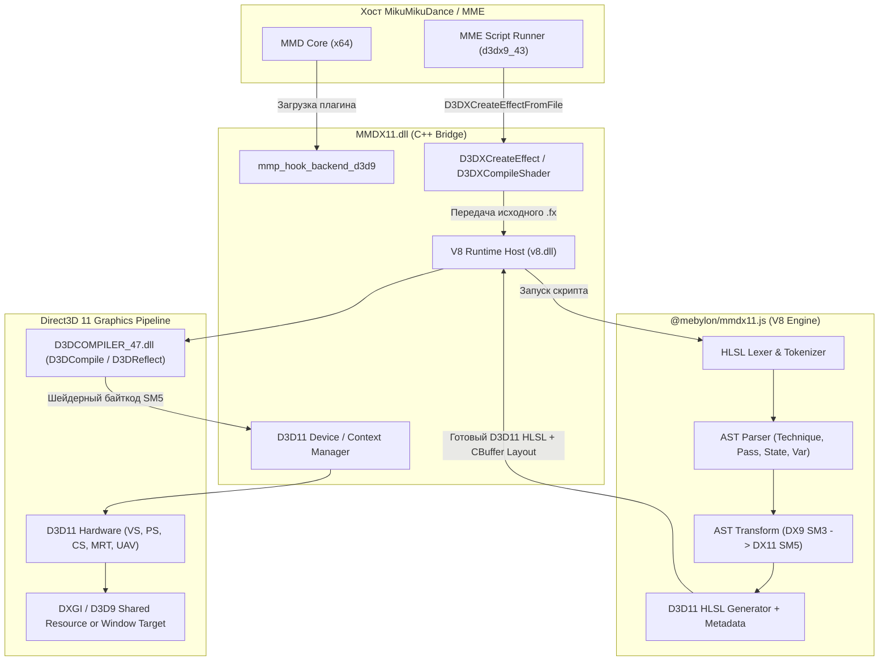

# Архитектурный отчёт: Реверс-инжиниринг MMDX11 и перенос в Hikari

## 1. Резюме архитектуры MMDX11

В ходе статического и бинарного реверса бинарников `MMDX11.dll` и JavaScript-компонента `@mebylon/mmdx11.js` установлено, что **MMDX11 спроектирован как гибридный шейдерный транслятор и графический мост**:

1. **C++ Core (`MMDX11.dll`)**:
   - Реализует экспорт `mmp_hook_backend_d3d9` для интеграции с загрузчиком плагинов MikuMikuPlugin (MMP).
   - Экспортирует и перехватывает функции подсистемы эффектов Direct3D 9 (`D3DXCreateEffect*`, `D3DXCompileShader*`).
   - Инициализирует изолированный рантайм **Google V8** (`v8.dll`, `icudtl.dat`, `snapshot_blob.bin`).
   - Создает нативное устройство **Direct3D 11** (`d3d11.dll`, `dxgi.dll`) и компилирует шейдеры через `D3DCOMPILER_47.dll`.
   - Включает встроенную библиотеку **DirectXTex** для загрузки текстур и генерации мип-уровней, а также **Assimp** для разбора геометрии.

2. **JavaScript AST Engine (`@mebylon/mmdx11.js`)**:
   - Полноценный компилятор/транслятор HLSL FX на базе архитектуры Babel/AST (5.5 МБ кода).
   - Выполняет синтаксический разбор специфичных конструкций MME/DX9 (`technique`, `pass`, стейты `StateAssignment`, маппинг текстур `TextureStateAssignment`).
   - Автоматически трансформирует синтаксис Shader Model 3.0 в современный Shader Model 5.0 (Direct3D 11):
     - Упаковывает свободные uniforms в константные буферы (`cbuffer` / `packoffset`).
     - Разделяет устаревшие спаренные сэмплеры DX9 (`sampler2D`) на `Texture2D` и `SamplerState`.
     - Преобразует техники и пассы MME в D3D11 Pipeline State Objects (PSO) и шейдерные этапы.
     - Добавляет поддержку Compute Shaders (`RWTexture2D`, `RWStructuredBuffer`).

---

## 2. Диаграмма взаимодействия компонентов



---

## 3. Ключевые различия: MMDX11 vs Hikari

| Характеристика | MMDX11 | Hikari (текущее состояние) | Целевое решение Hikari |
| :--- | :--- | :--- | :--- |
| **Язык реализации** | C++17 + Google V8 (JS) | Чистый Rust | Чистый Rust (без JS рантайма) |
| **Точка перехвата** | `mmp_hook_backend_d3d9` + D3DX9 экспорты | Direct3D 9 Vtable Interception | Нативный Vtable Hook + D3DX Effect Shim |
| **Разбор FX / MME** | Полноценный AST-парсер (`mmdx11.js`) | Простой regex/string scanning аннотаций | Строгий синтаксический парсер на Rust (`nom` / `winnow`) |
| **Трансляция шейдеров** | Динамическая генерация DX11 HLSL из AST | Требует ручной правки шейдеров под SM 5.0 | Авто-разбивка на `Texture2D` + `SamplerState` и генерация `cbuffer` |
| **Композитинг и вывод** | Нативный D3D11 рендер без CPU-копирования | **CPU Readback** (8.3 МБ/кадр через `UpdateSurface`) | **Zero-Copy DXGI Shared Handle** (`ID3D11Device::OpenSharedResource`) |
| **Стабильность** | Высокая (нет нагрузки на системную шину) | Access Violation в `ntdll` / `d3d9` | Устранение CPU-буферизации и гонок памяти |

---

## 4. Глубокий анализ подсистем MMDX11

### 4.1. Перехват D3DX API
Бинарник `MMDX11.dll` намеренно экспортирует функции D3DX9 (ординалы 675–687):
- `D3DXCreateEffect`, `D3DXCreateEffectFromFileA/W`, `D3DXCreateEffectFromResourceA/W`
- `D3DXCompileShader`, `D3DXCompileShaderFromFileA/W`
- `D3DXGetShaderInputSemantics`, `D3DXGetShaderVersion`

Когда MME пытается скомпилировать `.fx`-файл эффекта, вызов перехватывается MMDX11. Вместо создания устаревшего `ID3DXEffect` под D3D9, MMDX11:
1. Забирает текстовый буфер HLSL.
2. Передает его в изолированный контекст V8.
3. Возвращает MME фиктивный интерфейс `ID3DXEffect`, методы которого перенаправлены в D3D11-пайплайн.

### 4.2. Механизм трансляции в `@mebylon/mmdx11.js`
Внутри JavaScript-бандла определены все ключевые узлы грамматики HLSL:
```typescript
SyntaxNodeType = {
  TechniqueDeclaration: 51,
  TechniquePassDeclaration: 50,
  StateAssignment: 58,
  TextureStateAssignment: 59,
  PackoffsetDeclaration: 60,
  SamplerTypeDeclaration: 62,
  RegisterDeclaration: 63,
  BufferDeclaration: 66,
  BufferVariableDeclaration: 67,
  DiscardStatement: 69
}
```
Транслятор автоматически выполняет:
- **Разделение Sampler / Texture**: конструкции вида `sampler2D DiffuseSampler = sampler_state { Texture = <DiffuseMap>; };` преобразуются в `Texture2D DiffuseMap : register(t0);` и `SamplerState DiffuseSampler : register(s0);`.
- **CBuffer Packing**: глобальные переменные и матрицы MMD (`WORLD`, `VIEW`, `PROJECTION`) заворачиваются в `cbuffer MMDConstants : register(b0)`.
- **Pass State Mapping**: стейты пасса (`ZEnable`, `AlphaBlendEnable`, `CullMode`) преобразуются в дескрипторы `D3D11_BLEND_DESC`, `D3D11_DEPTH_STENCIL_DESC`, `D3D11_RASTERIZER_DESC`.

### 4.3. Вывод кадров и отсутствие Readback
MMDX11 не производит синхронный `CopyResource` на CPU с последующим вызовом `UpdateSurface` в D3D9. Рендеринг выполняется либо:
1. Напрямую в окно MMD через подмену SwapChain / Present;
2. Либо через создание Direct3D 9Ex / DXGI Shared Surface (`HANDLE shared_handle` через `CreateTexture` в D3D9 и открытие через `OpenSharedResource` в D3D11), что дает **нулевое копирование (Zero-Copy)** целиком на GPU.

---

## 5. Дорожная карта реализации в Hikari (Rust)

> [!IMPORTANT]
> Для достижения производительности и совместимости уровня MMDX11 в Hikari необходимо реализовать два ключевых блока: ликвидировать CPU Readback и создать автоматический парсер-транслятор шейдеров.

### Этап 1: Zero-Copy D3D9 ↔ D3D11 Interop (Приоритет: Критический)
1. **Удалить CPU Readback**:
   - Полностью исключить staging buffer и чтение 8.3 МБ в системную память в `crates/core/src/targets.rs` и `backend.rs`.
2. **DXGI Shared Handles**:
   - Создавать текстуру буфера кадра в D3D9Ex / D3D9 с флагом shared handle.
   - Открывать её в D3D11 через `ID3D11Device::OpenSharedResource` или `ID3D11Device1::OpenSharedResource1`.
   - Выполнять GPU-to-GPU копирование через `ID3D11DeviceContext::CopyResource` без участия процессора.

### Этап 2: Rust-native HLSL Transpiler (в `crates/effects`)
Вместо интеграции тяжелого V8 рантайма реализовать легковесный парсер на Rust:
1. **Лексер/парсер на базе `winnow` или `nom`**:
   - Парсинг блоков `technique` и `pass`.
   - Выделение стейтов пасса (`ZEnable`, `BlendOp`, `AlphaBlendEnable`) для формирования `D3D11_DEPTH_STENCIL_DESC` и `D3D11_BLEND_DESC`.
2. **Трансформация сигнатур функций и сэмплеров**:
   - Замена вызовов `tex2D(samp, uv)` на `tex.Sample(samp, uv)`.
   - Автоматическая группировка скаляров и матриц в `cbuffer Globals : register(b0)`.
   - Привязка шейдеров `vs_5_0` и `ps_5_0` к этапам контекста.

### Этап 3: Подмена MME Effect API
1. **Полноценная реализация `ID3DXEffect`**:
   - Реализовать все методы `SetMatrix`, `SetVector`, `SetFloat`, `SetTexture` через маппинг в слоты `b0` константного буфера.
   - Корректная обработка циклов `Begin`, `BeginPass`, `CommitChanges`, `EndPass`, `End`.
